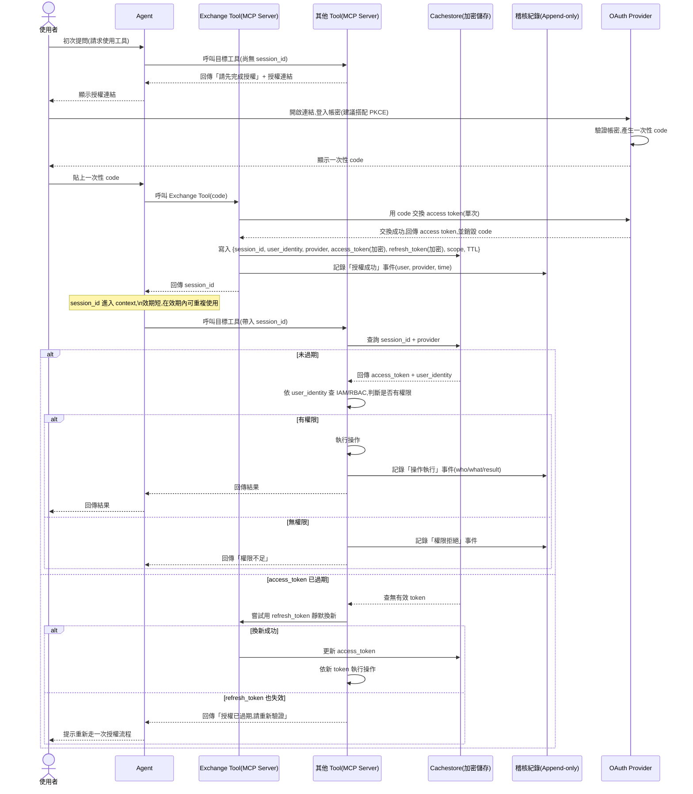
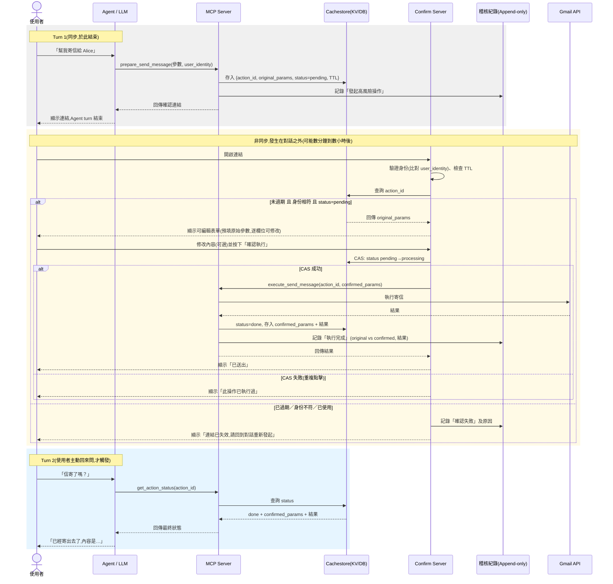

# authcode-mcp

用 [FastMCP](https://gofastmcp.com) 實作的 Gmail MCP Server。Agent 透過「使用者貼上一次性授權碼」的方式取得 Gmail 權限,所有會改變信箱狀態的操作(寄信、改 label、刪草稿…)都要使用者在瀏覽器上親自確認才會執行,每一次執行都留下可查詢的稽核紀錄。

## 功能

- **一次性授權碼登入**:Agent 給使用者授權連結 → 使用者登入 Google、複製頁面上的授權碼貼回 → Agent 換成短效 `session_id`。access token 只存在伺服器端,不會交給 Agent。
- **15 個 Gmail tool**:6 個唯讀(列信、讀信、讀對話串、列 label、讀附件、列草稿)直接執行;9 個有副作用的(寄信、改 label、封存、丟垃圾桶/還原、草稿的新增/修改/刪除/寄出)預設要經過使用者確認。
- **使用者同意頁面**:需要確認的 tool 只會回傳一個確認連結。使用者在頁面上可以先修改內容(收件人、主旨、內容、label)再確認送出,也可以直接取消。
- **稽核紀錄**:記錄誰、什麼時候、用了哪個 tool、結果如何,在 `/audit` 頁面查看。只記識別碼等元數據,不記信件主旨與內容。
- **事後查詢**:`get_action_status(action_id)` 讓 Agent 在之後(甚至下一次對話)查詢某個待確認動作是還在等確認、已成功、已失敗,還是已取消。
- **可替換的儲存層**:session、待確認動作、稽核紀錄目前都存在記憶體;有寫好 Redis 版本的實作可以替換(未經實際 Redis 測試)。

## 流程

圖上分開畫的 Exchange Tool、其他 Tool、Confirm Server,實作上都在同一個 MCP Server 裡。圖的原始檔在 [docs/ExchangeCode.md](docs/ExchangeCode.md) 與 [docs/Confirm.md](docs/Confirm.md)。

### 授權

Agent 第一次呼叫 Gmail tool 時拿到授權連結;使用者登入 Google 後,在 `/oauth/callback` 頁面複製授權碼貼回給 Agent,Agent 換成 `session_id`,之後的呼叫都帶著它。



### 使用者確認

有副作用的 tool 不會直接執行,而是回傳確認連結;使用者可以在頁面上修改內容後確認,或直接取消。結果都會寫進稽核紀錄,Agent 之後可以用 `get_action_status` 查詢。



## 快速開始

### 1. 建立 Google OAuth 用戶端

1. 在 [Google Cloud Console](https://console.cloud.google.com/) 建立專案並啟用 **Gmail API**。
2. 到「OAuth 用戶端 ID」建立一個**網頁應用程式**類型的憑證,「已授權的重新導向 URI」填 `http://localhost:8000/oauth/callback`。
3. OAuth 同意畫面如果是「測試中」狀態,要把要登入的 Google 帳號加進測試使用者。

### 2. 設定

```bash
cp .env.example .env
```

填入 `GOOGLE_CLIENT_ID`、`GOOGLE_CLIENT_SECRET`,並把 `STATE_SECRET` 換成一串長的隨機字串,例如:

```bash
python -c "import secrets; print(secrets.token_urlsafe(32))"
```

### 3. 安裝並啟動

```bash
pip install -e .
authcode-mcp
```

要在**專案根目錄**下執行,因為設定是從目前目錄的 `.env` 讀取。

不想安裝成套件的話,也可以 `pip install -r requirements.txt` 後用 `PYTHONPATH=src python -m authcode_mcp.server` 啟動(PowerShell 是 `$env:PYTHONPATH="src"; python -m authcode_mcp.server`)。

啟動後 MCP 端點在 `http://localhost:8000/mcp`(streamable HTTP)。

## 端點

| 路徑 | 用途 |
|---|---|
| `/mcp` | MCP 端點,給 Agent / MCP client 連線 |
| `/oauth/callback` | Google 授權完成後導回的頁面,顯示一次性授權碼讓使用者複製 |
| `/confirm/{action_id}` | 使用者同意頁面:預覽並可修改內容,按「確認送出」或「取消」 |
| `/audit` | 稽核紀錄列表,`?limit=` 調整筆數(最多 500),不同使用者以不同底色區分 |

## Tools

| Tool | 說明 | 需要確認 |
|---|---|---|
| `exchange_google_code(code)` | 用授權碼換取 `session_id` | – |
| `get_action_status(action_id)` | 查詢待確認動作的狀態 | – |
| `gmail_list_messages` / `gmail_get_message` / `gmail_get_thread` | 列信、讀信、讀對話串 | 否 |
| `gmail_list_labels` / `gmail_get_attachment` / `gmail_list_drafts` | 列 label、讀附件、列草稿 | 否 |
| `gmail_send_message` | 寄信 | 是 |
| `gmail_modify_labels` / `gmail_archive_message` | 改 label、封存 | 是 |
| `gmail_trash_message` / `gmail_untrash_message` | 丟垃圾桶、從垃圾桶還原 | 是 |
| `gmail_create_draft` / `gmail_update_draft` / `gmail_delete_draft` / `gmail_send_draft` | 草稿的新增、修改、刪除、寄出 | 是 |

Gmail tool 都要帶 `session_id`。沒帶或已過期時不會報錯,而是回傳 `{"status": "unauthenticated" | "session_expired", "auth_url": ...}`,Agent 把 `auth_url` 交給使用者重新授權即可。

需要確認的 tool 回傳 `{"status": "pending_confirmation", "action_id": ..., "confirm_url": ...}`,動作要等使用者打開 `confirm_url` 按下確認才會真的執行。

## 設定項目

FastMCP 本身的設定用 `FASTMCP_` 前綴,由 FastMCP 直接讀取(完整清單見 [FastMCP Settings](https://gofastmcp.com/more/settings));其餘是本專案的設定,沒有前綴。

| 變數 | 預設值 | 說明 |
|---|---|---|
| `GOOGLE_CLIENT_ID` / `GOOGLE_CLIENT_SECRET` | (必填) | Google OAuth 用戶端憑證 |
| `OAUTH_REDIRECT_URI` | (必填) | 要跟 Google Console 上設定的完全一致 |
| `STATE_SECRET` | (必填) | 簽署 OAuth `state` 的密鑰(CSRF 防護) |
| `PUBLIC_BASE_URL` | `http://localhost:8000` | 用來組出確認連結的對外網址 |
| `MAX_SESSION_TTL_SECONDS` | `600` | session 存活上限(秒) |
| `OAUTH_STATE_MAX_AGE_SECONDS` | `300` | 授權連結的有效期限(秒) |
| `PENDING_ACTION_TTL_SECONDS` | `300` | 確認連結的有效期限(秒) |
| `AUDIT_LOG_TTL_SECONDS` | `2592000` | 稽核紀錄保留時間(秒,30 天) |
| `GMAIL_ENABLED_TOOLS` | 全部 15 個 | 逗號分隔,要註冊哪些 Gmail tool |
| `CONFIRM_REQUIRED_TOOLS` | 9 個有副作用的 tool | 逗號分隔,哪些 tool 要先經過使用者確認 |
| `FASTMCP_HOST` | `127.0.0.1`(範本設 `0.0.0.0`) | 綁定位址 |
| `FASTMCP_PORT` | `8000` | 埠號 |
| `FASTMCP_LOG_LEVEL` | `INFO` | 日誌等級 |
| `FASTMCP_STATELESS_HTTP` | `false`(範本設 `true`) | 不保留 MCP 協定層 session |

transport 在程式碼裡固定為 `http`,不受 `FASTMCP_TRANSPORT` 影響——`stdio` 不會開 HTTP,上面的授權、確認、稽核頁面都會失效。

## 測試用 client

兩個範例 Agent 都連到 `http://localhost:8000/mcp`,啟動前要先把 server 跑起來。它們各自有自己的相依,跟 server 本體分開安裝。

**Google ADK**(`adk_agent/`)

```bash
cd adk_agent
pip install -r requirements.txt
# 在 adk_agent/gmail_agent/.env 填 GOOGLE_API_KEY
adk web
```

**Claude Agent SDK**(`claude_agent/`)

```bash
pip install -r claude_agent/requirements.txt
python claude_agent/agent.py
```

需要 Claude Agent SDK 的認證(例如設定 `ANTHROPIC_API_KEY`)。

## 安全注意事項

- **`/audit` 沒有任何存取控制**,能連到 server 的人都看得到所有使用者的操作紀錄。範本把 `FASTMCP_HOST` 設成 `0.0.0.0`,同一個區域網路的其他裝置也連得到;只在本機使用的話,改成 `127.0.0.1`。部署到 localhost 以外之前,必須先幫 `/audit` 加上存取控制。
- **確認連結本身就是憑證**:拿到連結的人就能確認或取消該動作。連結只應該交給發起請求的使用者,不要貼到公開的地方。
- **`.env` 含有 client secret**,已被 `.gitignore` 忽略,不要進版控。
- **資料都在記憶體裡**:server 重啟後,所有 session、待確認動作、稽核紀錄都會清空。

## 專案結構

```
src/authcode_mcp/
├── server.py        # 組裝 FastMCP app,啟動入口
├── config.py        # 設定
├── auth/            # OAuth 授權、/oauth/callback、exchange_google_code
├── gmail/           # Gmail API 封裝、15 個 tool、/confirm 同意頁面
├── cache/           # session / 待確認動作的儲存(記憶體、Redis)
└── audit/           # 稽核紀錄儲存、/audit 頁面、get_action_status
docs/                # 流程循序圖與設計參考文件
adk_agent/、claude_agent/  # 測試用 client
```
