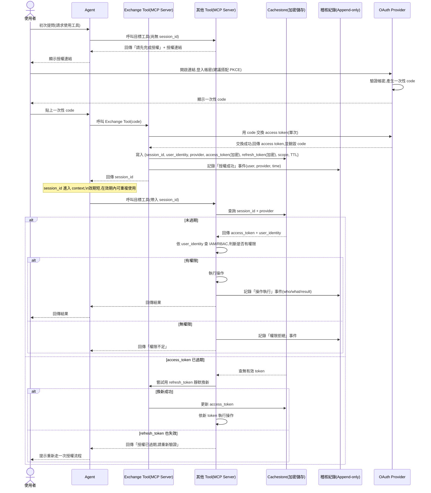
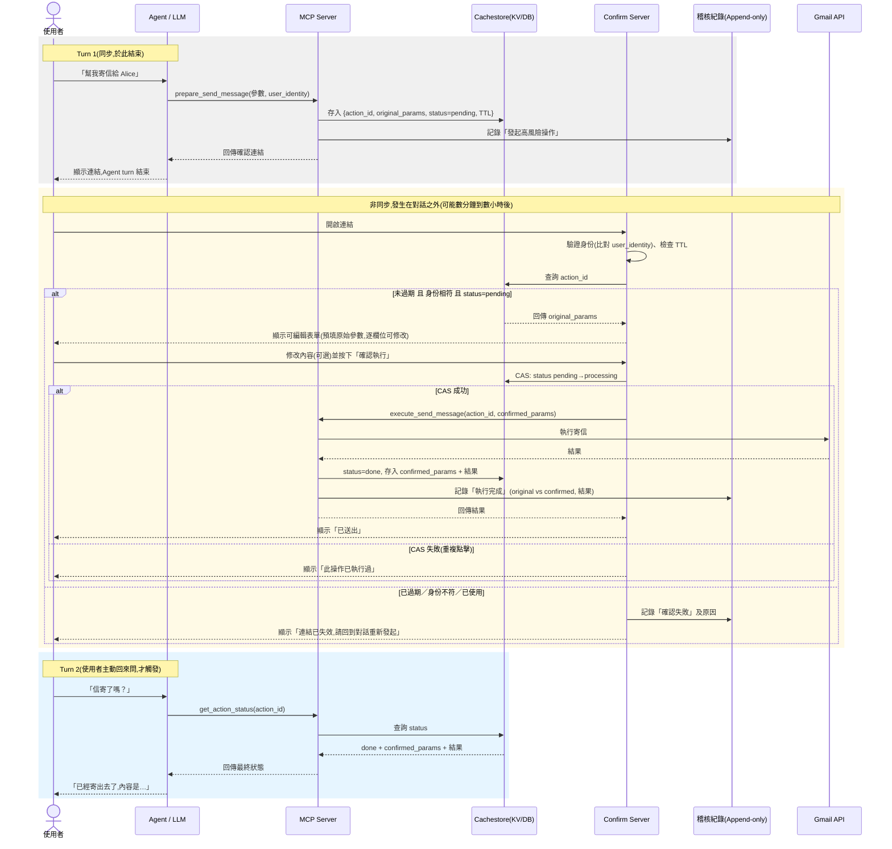

# Agent 作為使用者代理：權限、風險控管與稽核設計

## 一、核心問題

當 Agent 以「使用者代理」的身份執行操作時，必須同時滿足三項要求：

**1. 權限不可越界（Authorization Alignment）**

同一支 Agent，因使用者身份不同，可存取的資料與可執行的操作範圍也應不同，且此判斷不能交由 Agent 自行決定，須有外部機制強制執行。

> 例：業務專員只能查看自己的報價單；業務經理可查看所有專員的報價單。

**2. 高風險操作需要人工確認且可修改（HITL with Editable Confirmation）**

涉及資料異動、金額、不可逆動作等高風險操作，須先由使用者確認，且使用者要能在執行前修改內容，而非只能同意或拒絕。

> 例：業務專員用 Agent 建立報價單，Agent 須先讓專員確認並可修改報價內容，才實際建立報價單。

**3. 操作須可稽核（Auditability）**

所有操作（尤其是異動性操作）都要留下可追溯、不可竄改的紀錄——誰、在什麼時間、對什麼資料、做了什麼操作、結果為何，且應區分「AI 原始建議」與「使用者最終確認版本」。

> 例：業務專員刪除報價單的行為，須被完整記錄。

---

## 二、現行做法的困境

業界常見做法是在應用層自行實作 HITL，但會遇到兩個結構性問題：

**1. Agent 平台本身能力不足**

多數 Agent 平台（或框架）並未原生支援：

- 工具基於使用者委任授權
- 執行前的使用者確認機制
- 標準化的稽核軌跡（audit trail）

**2. 自行開發的耦合問題**

中斷 Agent 的工具呼叫事件來實作確認流程：

- 前端必須跟著改動（例如彈出 OAuth 驗證視窗、確認/編輯介面）
- 這套邏輯與特定 Agent 平台的事件機制綁死，換一個 Agent 平台就要重做一次
- 難以橫向複用在多個 Agent 應用上，維護成本隨 Agent 數量線性增加

---

## 三、MCP Server 方案

將權限控管、HITL 確認、稽核紀錄，從「Agent 應用層」下沉到「MCP Server（工具層）」來實作：

**1. 平台無關（Platform Agnostic）**

只要 Agent 平台支援 MCP 協議即可串接，不需為每個平台重新實作一套權限/確認/稽核邏輯，控管邏輯與 Agent 本身解耦。

**2. 熱插拔（Plug-and-Play）**

控管邏輯封裝成 MCP Server 後，新增 Agent 應用只需「掛上」此 MCP Server，即可繼承同一套權限模型、確認機制與稽核能力，不需重工。

**3. 三項需求的具體實作對應**

| 需求 | MCP Server 對應機制 |
|---|---|
| 權限對齊 | Exchange Tool 統一處理使用者身份的取得與交換，其他 Tool 執行操作前依此身份向 IAM/RBAC 查詢實際權限 |
| 高風險操作確認 | 以「prepare → 人工確認/編輯 → execute」兩段式設計，搭配獨立的 Confirm Server 網頁，並用 tool annotations（如 destructiveHint）標記高風險工具 |
| 稽核 | 稽核紀錄寫在獨立於業務儲存的 append-only 儲存，記錄執行參數、執行結果 |

---

## 四、身份傳遞機制（Identity Propagation）

MCP Server 要拿到的是「當下操作者」的身份，而不是「Agent 應用」本身的服務身份。

### 4.1 基本流程

1. 使用者首次呼叫工具時尚無憑證，Agent 收到「請先完成授權」提示與授權連結
2. 使用者透過瀏覽器完成 OAuth 登入，取得一次性 code（建議搭配 PKCE，避免攔截後被搶先兌換）
3. 使用者將 code 貼回 Agent，由專責的 **Exchange Tool** 向 OAuth Provider 兌換 access token（用畢即銷毀）
4. Exchange Tool 產生短效、不可猜測的 `session_id`，與加密後的 access token、使用者身份、授權範圍、TTL 一併寫入 Cachestore，回傳 `session_id` 給 Agent
5. Agent 之後呼叫其他工具只需附帶 `session_id`；工具端查 Cachestore 換回身份與 token 後執行操作，TTL 到期需重新驗證

### 4.2 流程圖



### 4.3 設計重點

- **`session_id` 安全等級等同憑證**：需綁定「使用者 + Agent session + 授權範圍」，而非單純查表用的 key，避免外洩後被冒用
- **Cachestore 不存明文 token**：access token／refresh token 應加密儲存，僅授權工具可解密，避免 Cachestore 一旦被讀取就等於洩漏所有使用者的憑證
- **需支援多 Provider／多 Scope**：一組 `session_id` 未來可能對應多個系統（Google、Salesforce、內部 IAM…），schema 應明確區分 provider 與對應的 token、scope
- **Authentication ≠ Authorization**：取得 access token 只代表「知道使用者是誰」，工具執行操作前仍須依此身份向 IAM/RBAC 查詢實際權限，這一步不能省略
- **Refresh Token 的優雅處理**：TTL 過期時，優先嘗試用 refresh token 靜默換新，換不到才要求使用者重新走完整授權流程，降低使用者頻繁登入的摩擦
- **通用化設計**：OAuth Provider 端應設計為可替換（Google／Microsoft／內部 SSO 皆可），呼應「平台無關」的核心精神

---

## 五、高風險操作確認機制（HITL Confirmation）

### 5.1 關鍵限制：Agent 的 turn 是同步的，確認流程是非同步的

Agent 回傳確認連結後，該次對話**立即結束**，不會、也無法卡在原地等待使用者完成瀏覽器端的確認。這代表：

- 使用者可能延遲很久才去點連結，甚至完全不處理
- 執行結果無法在同一個 turn 內回饋給使用者，只能靠「使用者下次主動開口」時，Agent 再去查詢狀態
- 因此 Agent 不能假裝「記得」結果——狀態的唯一真相來源永遠是後端 Cache／稽核紀錄，Agent 只是查詢者，不是狀態持有者

### 5.2 兩段式設計：prepare → 人工確認/編輯 → execute



### 5.3 設計重點

**編輯頁面（Confirm Server）：**

- 原始參數以獨立表單欄位呈現（非純文字/JSON），並標示「AI 建議內容，請確認或修改」
- 送出即代表確認，不需分開「編輯」與「確認」兩個按鈕
- 高風險欄位（如收件人）視業務需求決定是否開放編輯或改為唯讀
- 提供「取消」路徑，取消時 `status` 標記為 `cancelled` 並寫入稽核，避免卡在 pending 狀態

**資料設計：**

- Cache 同時保留 `original_params`（AI 生成）與 `confirmed_params`（使用者確認後），不互相覆蓋，供稽核比對差異
- 執行邏輯統一收斂在 MCP Server，Confirm Server 只負責確認/編輯介面與觸發執行請求，避免同一段業務邏輯（如呼叫 Gmail API）在兩處重複維護
- 用 CAS（Compare-And-Swap）防止重複點擊/併發造成重複執行

**Agent 端配合：**

- `action_id` 需能被 Agent 在後續對話中引用（存於對話歷史或以「使用者最近一次未完成操作」的語意反查）
- 提供 `get_action_status(action_id)` 工具，並在工具說明中明確引導 Agent：使用者詢問先前操作結果時應主動查詢，而非憑空回答
- 若使用者同時有多筆 pending 操作，Agent 需能一次查詢多筆狀態

**範例資料結構：**

```json
{
  "action_id": "xxx",
  "status": "pending",
  "user_identity": "...",
  "original_params": {
    "to": "alice@example.com",
    "subject": "...",
    "body": "..."
  },
  "confirmed_params": null,
  "created_at": "...",
  "ttl": "..."
}
```

使用者送出確認後：

```json
{
  "status": "processing",
  "confirmed_params": {
    "to": "alice@example.com, bob@example.com",
    "subject": "...(使用者改過的主旨)",
    "body": "...(使用者改過的內文)"
  },
  "confirmed_at": "...",
  "confirmed_by": "..."
}
```

---

## 六、稽核紀錄的落地原則

- 寫入獨立、唯寫（append-only）儲存，與 Cachestore（短效）及業務邏輯分離，避免同一系統被攻破後稽核紀錄一併遭竄改
- 至少涵蓋以下事件：
  - 授權成功／失敗
  - 操作發起（AI 原始建議）
  - 操作確認（使用者最終版本，含與原始版本的差異）
  - 執行結果
  - 權限拒絕
  - 連結過期／失效

---

## 七、權限模型的來源

MCP Server 的權限判斷邏輯建議直接對接既有 IAM／RBAC 系統，而非在 MCP Server 內重新維護一份權限表，避免兩邊權限定義不一致、日後難以同步維護。
